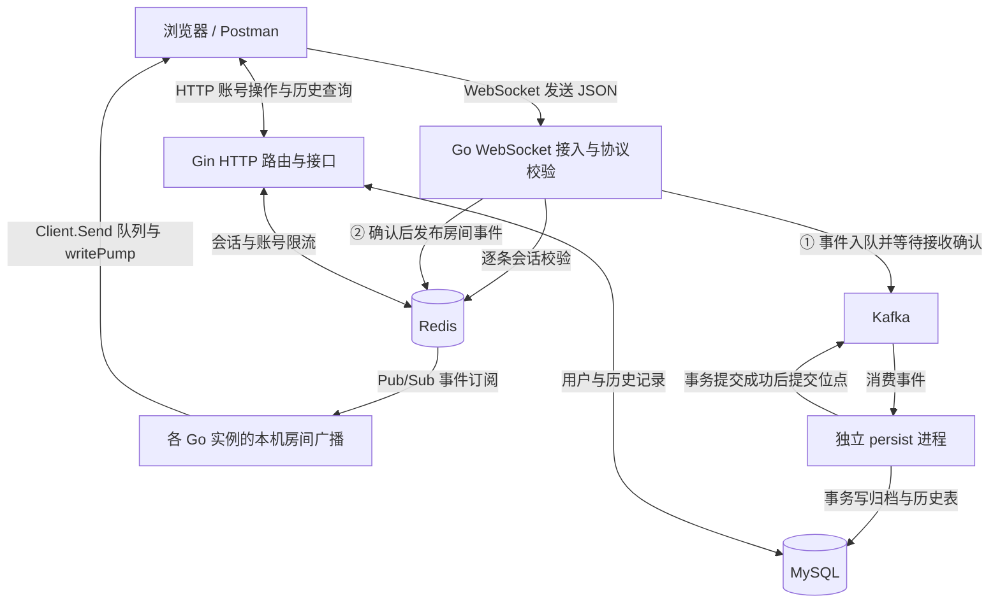

# GoliTube

基于 Go 的实时弹幕系统，提供房间收发、跨实例广播、账号会话、异步持久化与历史查询，并配有 YouTube 观看页风格的浏览器交互页面。

用户可以注册登录、进入房间、发送带播放位置和颜色的弹幕，再按播放时间查询已保存的历史。项目通过逐步实现、集成测试与故障实验，学习长连接管理、并发控制、消息消费和数据一致性。

## 已实现的功能

| 模块 | 当前能力 |
| --- | --- |
| 浏览器页面 | 房间输入、滚动弹幕舞台、实时聊天、发送表单、账号窗口、历史分页与移动端布局 |
| 账号会话 | 注册、登录、当前身份查询、退出，使用 bcrypt 密码哈希和 Redis/Cookie 会话 |
| 发送鉴权 | 游客接收公开弹幕，发送前逐条校验会话，服务端确定作者 `user_id` |
| 房间管理 | 房间隔离、连接加入与移除、空房间回收 |
| 连接治理 | 独立发送队列、单写协程、慢连接淘汰、Ping/Pong 心跳及读写超时 |
| 跨实例广播 | Redis Pub/Sub 分发房间事件，各 Go 实例向本机同房间连接广播 |
| 异步持久化 | Kafka 接收事件，独立消费者写入 MySQL，事务提交成功后提交消费位点 |
| 历史查询 | 按房间及播放位置范围查询，联合索引、游标分页、旧归档回填 |

## 技术栈

| 层次 | 技术 |
| --- | --- |
| HTTP 与长连接 | Go、Gin、`net/http`、Gorilla WebSocket |
| 前端 | 原生 HTML、CSS、JavaScript，通过 Go embed 内嵌提供 |
| 会话与实时广播 | Redis、go-redis |
| 消息队列 | Kafka、kafka-go |
| 业务存储 | MySQL、`database/sql` |
| 本地依赖管理 | Docker Compose |

## 快速开始

### 1. 准备环境

- Go 版本满足 [go.mod](go.mod) 的要求，当前为 `1.26.5`。
- Docker Engine 或已启动的 Docker Desktop，以及 Docker Compose v2。
- 可访问的 Redis，默认地址为 `127.0.0.1:6379`。

```powershell
git clone https://github.com/radianceded/GoliTube.git
cd GoliTube
```

Windows 使用 WSL Ubuntu 中的 Redis 时，开发期间保持一个 `wsl -d Ubuntu` 终端开启，在其中运行 `redis-cli ping` 并确认返回 `PONG`。WSL 会话停止可能导致 Windows 侧 Redis 端口不可用。

Compose 管理 Kafka、MySQL 和 Kafka 主题初始化任务。Redis 使用上述独立实例。

```powershell
docker compose up -d --wait kafka mysql
docker compose run --rm kafka-init
```

| 服务 | 本机地址 | 用途 |
| --- | --- | --- |
| Redis | `127.0.0.1:6379` | 登录会话、账号限流、实时广播 |
| Kafka | `127.0.0.1:19092` | 弹幕持久化事件 |
| MySQL | `127.0.0.1:13306` | 用户、弹幕归档与历史查询 |

Kafka 与 MySQL 数据保存在 Compose 命名卷中。`docker compose stop` 可停止依赖并保留数据。Compose 中的凭据用于本地开发，服务端口绑定本机。

### 2. 初始化数据库

在项目根目录的 PowerShell 中执行。该命令创建所需表、补充历史表作者字段，并回填符合正式弹幕协议的归档。

```powershell
$env:GOLITUBE_MYSQL_DSN = 'golitube:golitube-local@tcp(127.0.0.1:13306)/golitube'
go run . -mode migrate-history
```

已有部署升级时，先停止旧版 persist 消费者，再执行初始化并启动新版服务。命令可重复运行，旧弹幕缺失的作者保留为空。

### 3. 启动 HTTP/WebSocket 服务

在终端 A 中执行。服务启动时会连接 Redis，并等待频道订阅确认。

```powershell
$env:GOLITUBE_MYSQL_DSN = 'golitube:golitube-local@tcp(127.0.0.1:13306)/golitube'
go run . -addr localhost:8081 -redis-addr 127.0.0.1:6379 -kafka-brokers 127.0.0.1:19092
```

### 4. 启动持久化消费者

在终端 B 中执行。两个终端分别设置环境变量，并使用同一个数据库。

```powershell
$env:GOLITUBE_MYSQL_DSN = 'golitube:golitube-local@tcp(127.0.0.1:13306)/golitube'
go run . -mode persist -kafka-brokers 127.0.0.1:19092
```

### 5. 打开网页

访问 [http://localhost:8081/](http://localhost:8081/)。页面资源已经内嵌在 Go 程序中，直接随服务启动。

1. 输入房间号，例如 `1001`，点击进入房间。游客可以接收实时消息。
2. 点击右上角登录或注册。网页注册成功后自动登录，并更新已连接房间的会话。
3. 输入弹幕、播放位置和颜色，点击发送。网页中的播放位置使用秒，接口使用毫秒，例如 `12.5` 秒对应 `12500` 毫秒。
4. 打开另一个窗口，进入同一房间，检查弹幕同步。使用不同房间号可验证隔离。
5. 在历史区选择最长 60 秒的播放区间，查询已保存的弹幕并加载下一页。异步保存存在延迟，可以稍后重新查询。
6. 点击退出，页面会重建游客连接，继续接收房间弹幕。

实时区显示最近 200 条消息，历史区最多显示 1,000 条。网络中断后自动退避重连并保留草稿。重连后可手动重试发送，或通过历史查询补看已保存的消息。

### 验证两个 Go 实例互通

在终端 C 启动第二个服务实例，连接同一组 Redis、Kafka 与 MySQL。

```powershell
$env:GOLITUBE_MYSQL_DSN = 'golitube:golitube-local@tcp(127.0.0.1:13306)/golitube'
go run . -addr localhost:8082 -redis-addr 127.0.0.1:6379 -kafka-brokers 127.0.0.1:19092
```

分别在 `http://localhost:8081/` 和 `http://localhost:8082/` 进入 `1001` 房间，登录后发送消息，检查两个页面的接收结果。浏览器会话使用相同的主机名，例如始终使用 `localhost`。

## 消息链路



Kafka 与 Redis 由接收消息的 Go 流程依次写入。异步处理的是后续 MySQL 保存，实时发送流程会等待 Kafka 确认。

HTTP 入口由 `router.go` 中的 Gin Engine 统一注册，账号接口使用 `/auth` 路由组，历史接口使用 `/danmaku` 路由组。现有处理函数通过 Gin 的适配器接收标准 HTTP 请求，保留严格 JSON 校验、Cookie 与错误响应约定。恢复中间件在处理异常时返回通用错误，并记录方法和路由。原始请求转储被丢弃，以保护 Cookie、令牌等信息。WebSocket 经 Gin 路由交给 Gorilla 升级，发送鉴权仍逐条执行。

### 可靠性与连接约定

- 每条发送都查询握手 Cookie 对应的 Redis 会话。退出、过期或令牌轮换后，旧连接下次发送会收到私有错误。原生客户端重新登录后需要重连，网页会自动处理。
- 新弹幕的作者由服务端填写，广播、Kafka 事件、数据库归档和历史查询使用同一份身份。旧归档保留未知作者。
- 消费者写库失败时重试当前事件，事务提交成功后才提交位点。事件 ID 主键用于重复消费时的幂等写入。
- Kafka 已接收而 Redis 发布失败时，事件仍可能保存。客户端收到实时广播时，数据库保存也可能仍在进行中。
- Redis Pub/Sub 分发在线消息，离线补看通过历史查询完成。当前所有 Go 实例订阅同一个公共频道，再按房间向本机连接分发。
- 广播向每连接的 256 条发送队列非阻塞入队，队列满时移除慢连接。业务消息由该连接的单个 `writePump` 写入网络。

| 参数 | 当前设置 |
| --- | --- |
| 房间名 | 去掉首尾空白后最多 128 个 UTF-8 字节，空值使用 `lobby` |
| 弹幕内容 | 1～255 个 Unicode 码点，校验换行与控制字符 |
| WebSocket 输入帧 | 最多 4 KiB |
| 心跳 | 每 25 秒 Ping，收到 Pong 后延长 60 秒读期限 |
| 单次网络写入 | 5 秒超时 |
| 登录会话 | 固定 24 小时，退出撤销当前会话，重新登录轮换当前令牌 |
| 注册与登录限流 | 每个直连 IP 共用 60 秒窗口，最多 30 次请求 |
| 历史查询 | 每次最多 60 秒，默认 200 条，最多 500 条，网页默认每页 20 条 |

## 接口与协议

| 方法 | 路径 | 用途 |
| --- | --- | --- |
| GET | `/` | 浏览器交互页面 |
| GET | `/health` | HTTP 存活检查，返回 `ccb` |
| POST | `/auth/register` | 注册账号 |
| POST | `/auth/login` | 登录并设置会话 Cookie |
| GET | `/auth/me` | 查询当前登录身份 |
| POST | `/auth/logout` | 撤销当前会话并清除 Cookie |
| GET / WebSocket Upgrade | `/ws?room=1001` | 加入房间、接收与发送弹幕 |
| GET | `/danmaku/history?room=1001&start_ms=0&end_ms=60000` | 查询播放区间 `[0, 60000)` 的历史弹幕 |

客户端通过 WebSocket 文本帧发送业务字段。

```json
{"content":"你好","position_ms":12500,"color":"#ff8800"}
```

同房间成员收到服务端生成的弹幕，以下字段值为示例。

```json
{
  "type": "danmaku",
  "id": "server-generated-id",
  "room_id": "1001",
  "user_id": "authenticated-user-id",
  "content": "你好",
  "position_ms": 12500,
  "color": "#ff8800",
  "created_at_ms": 1794000000000
}
```

`position_ms` 表示播放位置，`created_at_ms` 表示服务端接收时间。发送者身份、事件 ID、房间和接收时间均由服务端确定。格式或权限错误通过私有 `error` 消息返回发送者。

字段规则、错误码、Cookie 使用与游标约定分别见 [弹幕协议](docs/danmaku-protocol.md)、[账号流程](docs/accounts.md) 和 [历史查询](docs/history-query.md)。

## 测试与验证

### 基础检查

```powershell
go test -race -timeout 30s ./...
go vet ./...
git diff --check
```

基础测试覆盖协议、房间与传输行为、发送鉴权失败、历史参数和静态资源路由。真实中间件测试通过环境变量单独启用。

### MySQL / Redis 集成测试

先准备已授权、名称以 `_test` 结尾的独立 MySQL 数据库，再执行。

```powershell
$env:GOLITUBE_TEST_MYSQL_DSN = 'golitube:golitube-local@tcp(127.0.0.1:13306)/golitube_test'
$env:GOLITUBE_TEST_REDIS_ADDR = '127.0.0.1:6379'
go test -race -v -run '^(TestAuthIntegration|TestHistoryIntegration|TestCrossInstanceBroadcast)$' -timeout 60s .
```

| 已执行的验证 | 覆盖内容 |
| --- | --- |
| 账号与发送鉴权 | 注册登录、游客接收、防伪造作者、退出/过期/轮换后已有连接发送失效 |
| 跨进程广播 | 两个独立 Go 实例的同房间互通与跨房间隔离 |
| 持久化与历史 | Kafka 到 MySQL 的完整链路、重复消费幂等、作者一致、游标分页与事务回滚 |
| 故障恢复 | 专用 Redis 重启后的订阅恢复、会话丢失处理，以及专用 MySQL 重启后的消费补存 |
| 浏览器交互 | 真实双浏览器会话、注册登录、23 条消息分页、服务重启重连、退出后接收、文本渲染及移动端宽度 |

浏览器交互验证于 2026-11-06 使用两个 server 进程、一个 persist 进程及真实 Redis、Kafka、MySQL 完成。历史查询 503 提示另用模拟 HTTP 响应验证。

当前部署与实验使用单节点中间件。吞吐量、最大连接数、P95/P99 和资源消耗属于后续压测记录项。上表中的消息数量与配置参数用于说明测试范围。

故障实验、测试开关和实际观察见 [异步持久化](docs/async-persistence.md) 与 [Redis 停服恢复](docs/redis-restart-experiment.md)。

## 代码入口

```text
main.go             启动与依赖装配、房间成员、WebSocket 收发与连接生命周期
router.go           Gin 路由、接口分组、恢复中间件与 HTTP 兼容处理
web.go              内嵌页面资源及静态路由
web/                浏览器页面、样式与交互逻辑
auth.go             账号、密码哈希、Redis 会话与账号限流
danmaku.go          弹幕输入校验与服务端事件生成
redis.go            跨实例房间事件发布与订阅
persistence.go      Kafka 生产消费、MySQL 事务与表结构初始化
history.go          历史查询、游标、查询表投影与归档回填
schema.sql          用户、弹幕归档及历史查询表
compose.yaml        Kafka、MySQL 与主题初始化
docs/               协议、运行说明与故障实验记录
```

## 后续计划

- 弹幕发送限流与滥用处理。
- 视频实体、上传、存储和播放，建立视频与弹幕的关联。
- 评论、回复与搜索等视频社区功能。
- 可复现压测、运行指标与基于测量结果的优化。
- 公网部署与多节点故障场景验证。

## 参考来源

- [charlesAcmen/live-stream-danmaku](https://github.com/charlesAcmen/live-stream-danmaku) 提供了 Go 弹幕场景、跨实例广播与异步持久化的参考思路。
- [blackirlsama/EchoFrame](https://github.com/blackirlsama/EchoFrame) 用于参考视频社区的业务范围与后续产品方向。

项目的设计取舍与验证结果记录在本仓库文档中。后续使用第三方代码时遵循对应许可证并保留来源声明。
