# GoliTube

基于 Go 的高性能实时弹幕后端系统，提供房间收发、跨实例广播、账号会话、双层限流、异步批量持久化、历史查询、在线统计与房间点赞，并配有 YouTube 观看页风格的浏览器交互页面。

在线演示：[https://radianced.cn/](https://radianced.cn/)

用户可以注册登录、进入房间、发送带播放位置和颜色的弹幕，再按播放时间查询已保存的历史。项目通过逐步实现、真实中间件集成测试、故障恢复实验与多轮容量压测，系统性实践长连接治理、并发控制、高吞吐消息消费与数据一致性。

## 已实现的功能

| 模块 | 当前能力 |
| --- | --- |
| 浏览器页面 | 房间输入、滚动弹幕舞台、实时聊天、发送表单、账号窗口、历史分页与移动端布局 |
| 账号会话 | 注册、登录、当前身份查询、退出，使用 bcrypt 密码哈希（含防时序枚举）和 Redis/Cookie 会话轮换 |
| 发送鉴权 | 游客接收公开弹幕，发送前逐条校验会话，服务端确定作者 `user_id` 与 `username` |
| 流量保护 | 单连接本地令牌桶（2 条/秒、突发 5 条、连续超限 50 次断开）+ 跨实例 Redis 用户窗口（10 条/5 秒） |
| 房间管理 | 房间隔离、连接加入与移除、空房间回收 |
| 连接治理 | 256 槽有界发送队列、单写协程、慢连接淘汰、Ping/Pong 心跳、读写超时、`WriteBufferPool` 写缓冲复用与优雅退出 |
| 跨实例广播 | Redis Pub/Sub 分发房间事件；房间级下行合包（满 50 条 / 48 KiB / 20ms，`danmaku_batch` 兼容单条）与 `PreparedMessage` 预打包帧复用 |
| 异步持久化 | Kafka Producer 按分区合批与 Snappy 压缩（500 条/10ms，保持同步确认）；独立消费者默认 3 分区并行批量写 MySQL（200 条/50ms），无冲突跳过 `FOR UPDATE`，不可重试数据约束错误自动降级逐条写库并转存死信 |
| 历史查询 | 按房间及播放位置范围查询，联合索引、游标分页、旧归档回填、版本化 Redis 历史缓存 |
| 在线统计 | 跨实例汇总在线连接数、实例租约过期回收、网页定时刷新 |
| 房间点赞 | 每个登录用户每房间一赞、取消点赞、Lua 原子幂等更新、跨实例共享总数与个人状态 |
| 可观测与压测 | 零外部依赖的 `/debug/metrics` 分段延迟直方图、按需 `/debug/pprof` 与独立压测工具 `cmd/loadtest` |

## 性能与压测表现

同机、全新隔离中间件栈（`deploy/loadtest/compose.yaml`：Redis 7.4、Kafka 4.1.0 3 分区、MySQL 8.4）下的对比压测结果，完整方法、环境与三轮调优记录见 [容量压测](docs/loadtest.md)、[2026-11-17 容量与高可用报告](docs/loadtest-report-20261117.md) 与 [2026-11-22 吞吐优化对比报告](docs/loadtest-report-20261122.md)：

| 场景 | 基线（优化前） | 优化后（当前 `main`） | 说明 |
| --- | --- | --- | --- |
| 空闲长连接 | — | **15,000 连接**（0 失败 / 0 断连） | RSS 710.8 MB（约 45 KB/连接，启用 `WriteBufferPool` 后常驻内存进一步降低） |
| 多房间 `mr-100x10`（1,000 TPS） | P99 137.0 ms / RSS 184.1 MB | P99 **45.7～47.1 ms** / RSS **128.3 MB** / 0 缺失 / 0 积压 | P99 降低约 66%，RSS 降低约 30% |
| 多房间 `mr-200x10`（2,000 TPS） | P99 34.7 s / 缺失 32.86% / 积压 +132（不通过） | P99 **90.8～138.0 ms** / **0.000% 缺失** / **0 积压** | Producer 合批 + 3 分区并行持久化全面通过（20,000 投递/秒） |
| 热点单房间 `hs-500x100` | 47.9k 投递/s / P99 57.7 ms / CPU 30.4% | **48.4k 投递/s** / P99 **58.4 ms** / CPU **23.1%** / RSS **143.4 MB** | CPU 降低 24%，RSS 降低 26% |
| 热点单房间 `hs-1000x200` | 40.6k 投递/s / P99 57.8 s / 缺失 61.15%（不通过） | **155.0k 投递/s** / P99 **114.0 ms** / **0.000% 缺失** / 0 断连 | 房间级 50 条/20ms 下行合包打通 15.5 万投递/秒（P99 提速 507 倍） |

> 上述为单机短时压测（每档 20s 预热 + 90s 正式测量），非独立压测机 30 分钟长稳结论。3,000 TPS 档位在单机 WSL2 虚拟磁盘上触及 MySQL 双表写入约 2,100 事件/秒（4,200 行/秒）的磁盘瓶颈。

## 技术栈

| 层次 | 技术 |
| --- | --- |
| HTTP 与长连接 | Go、Gin、`net/http`、Gorilla WebSocket |
| 前端 | 原生 HTML、CSS、JavaScript，通过 Go embed 内嵌提供 |
| 会话、缓存与实时状态 | Redis、go-redis |
| 消息队列 | Kafka、kafka-go |
| 业务存储 | MySQL、`database/sql` |
| 本地依赖与部署 | Docker Compose、systemd、Nginx、GitHub Actions |

## 快速开始

腾讯云 Ubuntu 部署、systemd 服务与 GitHub Actions 自动发布见 [部署文档](docs/deployment.md)。

### 1. 准备环境

- Go 版本满足 [go.mod](go.mod) 的要求，当前为 `1.26.5`。
- Docker Engine 或已启动的 Docker Desktop，以及 Docker Compose v2。
- 可访问的 Redis，默认地址为 `127.0.0.1:6379`。

```powershell
git clone https://github.com/radianceded/GoliTube.git
cd GoliTube
```

Windows 使用 WSL Ubuntu 中的 Redis 时，开发期间保持一个 `wsl -d Ubuntu` 终端开启，在其中运行 `redis-cli ping` 并确认返回 `PONG`。WSL 会话停止可能导致 Windows 侧 Redis 端口不可用。

Compose 管理 Kafka、MySQL 和 Kafka 主题初始化任务。Redis 使用上述独立实例。

```powershell
docker compose up -d --wait kafka mysql
docker compose run --rm kafka-init
```

| 服务 | 本机地址 | 用途 |
| --- | --- | --- |
| Redis | `127.0.0.1:6379` | 登录会话、账号与发送限流、实时广播、历史缓存、在线统计与房间点赞 |
| Kafka | `127.0.0.1:19092` | 弹幕持久化事件与死信队列 |
| MySQL | `127.0.0.1:13306` | 用户、弹幕归档与历史查询 |

Kafka 与 MySQL 数据保存在 Compose 命名卷中。`docker compose stop` 可停止依赖并保留数据。Compose 中的凭据用于本地开发，服务端口绑定本机。

### 2. 初始化数据库

在项目根目录的 PowerShell 中执行。该命令创建所需表、补充历史表作者字段，并回填符合正式弹幕协议的归档。

```powershell
$env:GOLITUBE_MYSQL_DSN = 'golitube:golitube-local@tcp(127.0.0.1:13306)/golitube'
go run ./cmd/golitube -mode migrate-history
```

已有部署升级时，先停止旧版 persist 消费者，再执行初始化并启动新版服务。命令可重复运行，旧弹幕缺失的作者保留为空。

### 3. 启动 HTTP/WebSocket 服务

在终端 A 中执行。服务启动时会连接 Redis，并等待频道订阅确认。

```powershell
$env:GOLITUBE_MYSQL_DSN = 'golitube:golitube-local@tcp(127.0.0.1:13306)/golitube'
go run ./cmd/golitube -addr localhost:8081 -redis-addr 127.0.0.1:6379 -kafka-brokers 127.0.0.1:19092
```

按需环境变量：`GOLITUBE_METRICS=1` 开启 `/debug/metrics` 与周期汇总日志，`GOLITUBE_PPROF=1` 开启 `/debug/pprof/*`，`GOLITUBE_QUIET=1` 关闭逐连接日志（压测推荐）。

### 4. 启动持久化消费者

在终端 B 中执行。两个终端分别设置环境变量，并使用同一个数据库。

```powershell
$env:GOLITUBE_MYSQL_DSN = 'golitube:golitube-local@tcp(127.0.0.1:13306)/golitube'
go run ./cmd/golitube -mode persist -kafka-brokers 127.0.0.1:19092
```

默认启动 3 个并行消费者（`-persist-workers`，范围 1～16，对应 topic 的 3 个分区），每批最多 200 条，首条消息到达后最多等待 50ms 收集同批消息。使用 `-persist-batch` 可设置 1～1000 条，设置为 1 可逐条处理。归档和历史投影在同一事务中批量写入，整批落库与死信转存成功后再提交消费位点。退出时未确认的批次会在重启后重新消费，事件 ID 保证幂等。

### 5. 打开网页

访问 [http://localhost:8081/](http://localhost:8081/)。页面资源已经内嵌在 Go 程序中，直接随服务启动。

1. 输入房间号，例如 `1001`，点击进入房间。游客可以接收实时消息。
2. 点击右上角登录或注册。网页注册成功后自动登录，并更新已连接房间的会话。
3. 输入弹幕、播放位置和颜色，点击发送。网页中的播放位置使用秒，接口使用毫秒，例如 `12.5` 秒对应 `12500` 毫秒。
4. 打开另一个窗口，进入同一房间，检查弹幕同步。使用不同房间号可验证隔离。
5. 在历史区选择最长 60 秒的播放区间，查询已保存的弹幕并加载下一页。异步保存存在延迟，可以稍后重新查询。
6. 点击退出，页面会重建游客连接，继续接收房间弹幕。
7. 登录并进入房间后，点击房间标题旁的点赞按钮，再次点击取消。刷新页面后重新进入房间，可以看到个人点赞状态。游客可查看总数，各实例的页面约每 3 秒同步一次。

实时区显示最近 200 条消息，历史区最多显示 1,000 条。网络中断后自动退避重连并保留草稿。重连后可手动重试发送，或通过历史查询补看已保存的消息。

### 验证两个 Go 实例互通

在终端 C 启动第二个服务实例，连接同一组 Redis、Kafka 与 MySQL。

```powershell
$env:GOLITUBE_MYSQL_DSN = 'golitube:golitube-local@tcp(127.0.0.1:13306)/golitube'
go run ./cmd/golitube -addr localhost:8082 -redis-addr 127.0.0.1:6379 -kafka-brokers 127.0.0.1:19092
```

分别在 `http://localhost:8081/` 和 `http://localhost:8082/` 进入 `1001` 房间，登录后发送消息，检查两个页面的接收结果。浏览器会话使用相同的主机名，例如始终使用 `localhost`。

## 消息链路

```mermaid
flowchart TD
    Client[浏览器 / 压测客户端] <-->|HTTP 账号操作与历史查询| API[Gin HTTP 路由与接口]
    Client -->|WebSocket 发送 JSON| WS[Go WebSocket 接入、令牌桶与协议校验]
    WS -->|逐条会话校验与用户窗口限流| Redis[(Redis)]
    WS -->|① 分区合批入队并等待确认| Kafka[Kafka]
    WS -->|② 确认后发布房间事件| Redis
    Redis -->|Pub/Sub 事件订阅| Instances[各 Go 实例房间级合包与 PreparedMessage 广播]
    Instances -->|Client.Send 队列与 writePump| Client
    Kafka -->|3 分区并行批量消费| Persist[独立 persist 进程]
    Persist -->|事务写归档与历史表（无冲突跳过 FOR UPDATE）| DB[(MySQL)]
    Persist -->|非法消息或不可重试数据错误转存| DLQ[Kafka 死信 Topic]
    Persist -->|事务与死信成功后提交位点| Kafka
    Persist -->|事务提交后切换历史缓存版本| Redis
    API <-->|用户与历史记录| DB
    API <-->|会话、限流、历史缓存、在线统计与点赞| Redis
    Instances -->|每 3 秒上报本机连接数| Redis
```



Kafka 与 Redis 由接收消息的 Go 流程依次写入。异步处理的是后续 MySQL 保存，实时发送流程仍等待 Kafka 确认（`Async=false`、`RequiredAcks=RequireAll`）；主链路 Producer 通过按分区并发合批（500 条 / 10ms / Snappy）摊薄 RPC 成本，死信 Producer 保持单条直写（`BatchSize=1`）。

HTTP 入口由 `internal/server/router.go` 中的 Gin Engine 统一注册，账号接口使用 `/auth` 路由组，历史接口使用 `/danmaku` 路由组。现有处理函数通过 Gin 的适配器接收标准 HTTP 请求，保留严格 JSON 校验、Cookie 与错误响应约定。恢复中间件在处理异常时返回通用错误，并记录方法和路由。原始请求转储被丢弃，以保护 Cookie、令牌等信息。WebSocket 经 Gin 路由交给 Gorilla 升级，发送鉴权仍逐条执行。

### Redis 历史缓存与在线统计

- 历史缓存采用 Cache Aside。只缓存起点对齐 30 秒、长度为 30 或 60 秒的第一页，键包含全部查询条件。非空结果有效期 10 秒，空结果 2 秒，命中不会续期，且从 TTL 中扣除数据库查询耗时。游标后续页与其他窗口直接查 MySQL。
- 缓存仅填充 MySQL 已提交的数据。persist 提交事务后通过 Redis pipeline 切换本批涉及房间的版本号，旧查询的并发回填写入旧版本键。版本保留 60 秒，旧页面按自身 TTL 回收。失效操作失败记录日志并继续持久化，短 TTL 限制旧结果存活时间。server 与 persist 必须连接同一 Redis，并同时升级消费者。
- Redis 缓存读写各使用最多 150 毫秒的预算，缓存异常时回源 MySQL，数据库查询失败不会缓存为空结果。冷缓存的并发请求仍可能同时回源，当前未做 `singleflight` 合并。
- 每个 server 使用随机实例身份，每 3 秒快照本机房间连接数，释放房间锁后上报 Redis。Hash 保存各实例计数，ZSET 保存 10 秒租约，Lua 使用 Redis 时钟原子更新与汇总。最后一条连接离开后，下次上报移除本实例贡献。
- `/rooms/online` 返回尚未过期的连接数。实例停止上报后，其贡献在最后一次成功上报的 10 秒租约到期后被排除。辅助键设置 20 秒 TTL。网页约每 3 秒查询一次，显示存在上报和轮询延迟，同一用户打开两个标签页计为两个连接。统计失败显示暂不可用。

### 房间点赞

- `GET /rooms/likes?room=1001` 返回 `{"room_id":"1001","likes":2,"liked":true}`。`likes` 是房间总数，`liked` 是当前会话用户的状态。游客或过期会话查询时 `liked` 为 false，未知房间总数为 0。响应使用 `Cache-Control: no-store`。
- `PUT /rooms/likes?room=1001` 接受 `{"liked":true}` 点赞、`{"liked":false}` 取消。服务端从 Redis 会话确定用户 ID，拒绝额外字段，写请求校验同源 Origin。游客修改返回 401，Redis 不可用返回 503。
- 每房间一个 Redis Set 保存用户 ID。Lua 内执行 `SADD` 或 `SREM`，再返回 `SCARD` 和 `SISMEMBER`，让操作与响应状态保持原子性。集合本身就是计数来源，同一用户重复点赞与重复取消均幂等。不同客户端同时提交相反状态时，以 Redis 实际执行顺序为准。
- 网页提交明确的目标状态，等待成功响应后更新按钮。读取失败显示暂不可用，写入响应丢失时重新查询当前状态。复用在线统计的轮询周期获取各实例共享的最新点赞数，切换房间或重连时丢弃旧请求结果。
- 点赞关系保存在 Redis，键不设置 TTL。Go 服务重启可继续读取同一 Redis 中的记录。Redis 重启后的恢复程度取决于部署的 RDB/AOF 配置，数据被清空或淘汰后，当前版本无法从 MySQL 重建点赞关系。容量随实际点赞关系增长。

### 可靠性与连接约定

- 每条发送都查询握手 Cookie 对应的 Redis 会话。退出、过期或令牌轮换后，旧连接下次发送会收到私有错误。原生客户端重新登录后需要重连，网页会自动处理。
- 新弹幕的作者由服务端填写，广播、Kafka 事件、数据库归档和历史查询使用同一份身份。旧归档保留未知作者。
- 消费者遇到可重试错误（如 MySQL 停服、死锁、超时）时每秒重试当前批次，事务提交成功后才提交位点；遇到不可重试的数据库约束错误（如字段超长、非法字符、CHECK 约束失败等）时，自动降级为逐条写库，将坏消息剥离转存到死信 topic `golitube-danmaku-dlq`，确保同批正常消息顺利落库且不阻塞分区消费。
- 批量写库在 `INSERT ... ON DUPLICATE KEY UPDATE id = id` 影响行数等于去重批大小（无重复/并发冲突）时直接投影 `danmaku_history`，跳过多余的 `SELECT ... FOR UPDATE`；一旦发生冲突或重放则自动回退锁定读，保证最初保存的归档胜出。
- Kafka 已接收而 Redis 发布失败时，事件仍可能保存。客户端收到实时广播时，数据库保存也可能仍在进行中。
- Redis Pub/Sub 分发在线消息，离线补看通过历史查询完成。当前所有 Go 实例订阅同一个公共频道，再按房间向本机连接分发。
- 下行广播启用房间级合包（满 50 条 / 累计 48 KiB / 首条满 20ms 刷出），单条保持原 `danmaku` 帧，多条封装为 `danmaku_batch`，通过 `PreparedMessage` 预打包一次后向每连接的 256 槽发送队列非阻塞入队，队列满时移除慢连接；优雅退出 `CloseAll` 前先排空所有未发出的房间合包。

| 参数 | 当前设置 |
| --- | --- |
| 房间名 | 去掉首尾空白后最多 128 个 UTF-8 字节，空值使用 `lobby` |
| 弹幕内容 | 1～255 个 Unicode 码点，校验换行与控制字符 |
| WebSocket 输入帧 | 最多 4 KiB |
| 房间下行合包 | 满 50 条、累计 48 KiB 或首条到达 20ms 刷出（单条不包装） |
| 心跳 | 每 25 秒 Ping，收到 Pong 后延长 60 秒读期限 |
| 单次网络写入 | 5 秒超时 |
| 登录会话 | 固定 24 小时，退出撤销当前会话，重新登录轮换当前令牌 |
| 注册与登录限流 | 每个直连 IP 共用 60 秒窗口，最多 30 次请求 |
| 弹幕发送限流 | 每连接每秒补充 2 个令牌、突发 5 条（连续超限 50 次关闭）；每用户跨连接每 5 秒最多 10 条 |
| Kafka Producer 合批 | 按分区最多 500 条或 10ms，Snappy 压缩，`Async=false`、`RequiredAcks=RequireAll` |
| 持久化消费者 | 默认 3 worker（1～16）、每批 200 条（1～1000）或 50ms / 1 MiB，MySQL 连接池 `16/8`（按需扩容） |
| 历史查询 | 每次最多 60 秒，默认 200 条，最多 500 条，网页默认每页 20 条 |

## 接口与协议

| 方法 | 路径 | 用途 |
| --- | --- | --- |
| GET | `/` | 浏览器交互页面 |
| GET | `/health` | HTTP 存活检查，返回 `ccb` |
| POST | `/auth/register` | 注册账号 |
| POST | `/auth/login` | 登录并设置会话 Cookie |
| GET | `/auth/me` | 查询当前登录身份 |
| POST | `/auth/logout` | 撤销当前会话并清除 Cookie |
| GET / WebSocket Upgrade | `/ws?room=1001` | 加入房间、接收与发送弹幕 |
| GET | `/danmaku/history?room=1001&start_ms=0&end_ms=60000` | 查询播放区间 `[0, 60000)` 的历史弹幕 |
| GET | `/rooms/online?room=1001` | 返回 `{"room_id":"1001","online_connections":2}`，未知房间返回 0 |
| GET | `/rooms/likes?room=1001` | 查询房间点赞总数与当前用户点赞状态 |
| PUT | `/rooms/likes?room=1001` | 设置 `{"liked":true}` 或 `{"liked":false}`，需要登录 |
| GET | `/debug/metrics` | 进程内指标与发布延迟分位快照（需 `GOLITUBE_METRICS=1`） |
| ANY | `/debug/pprof/*` | Go 运行时性能剖析端点（需 `GOLITUBE_PPROF=1`） |

客户端通过 WebSocket 文本帧发送业务字段：

```json
{"content":"你好","position_ms":12500,"color":"#ff8800"}
```

同房间成员收到服务端生成的单条弹幕：

```json
{
  "type": "danmaku",
  "id": "server-generated-id",
  "room_id": "1001",
  "username": "alice",
  "user_id": "authenticated-user-id",
  "content": "你好",
  "position_ms": 12500,
  "color": "#ff8800",
  "created_at_ms": 1794000000000
}
```

同一房间在 20ms 合包窗口内到达 2 条及以上弹幕时，下行合并为一个 `danmaku_batch` 文本帧：

```json
{
  "type": "danmaku_batch",
  "items": [
    {"type": "danmaku", "id": "...", "room_id": "1001", "username": "alice", "user_id": "...", "content": "第一条", "position_ms": 12500, "color": "#ff8800", "created_at_ms": 1794000000000},
    {"type": "danmaku", "id": "...", "room_id": "1001", "username": "bob", "user_id": "...", "content": "第二条", "position_ms": 12600, "color": "#ffffff", "created_at_ms": 1794000000010}
  ]
}
```

`position_ms` 表示播放位置，`created_at_ms` 表示服务端接收时间。发送者身份、事件 ID、房间和接收时间均由服务端确定。格式、限流或权限错误通过私有 `error` 消息返回发送者（不参与合包）。

字段规则、错误码、Cookie 使用与游标约定分别见 [弹幕协议](docs/danmaku-protocol.md)、[账号流程](docs/accounts.md) 和 [历史查询](docs/history-query.md)。

## 测试与验证

### 基础检查

```powershell
go test -race -timeout 30s ./...
go vet ./...
git diff --check
```

基础测试覆盖协议、房间与传输行为、下行合包、发送鉴权与双层限流、批量持久化与不可重试错误降级 DLQ、历史参数和静态资源路由。真实中间件测试通过环境变量单独启用，GitHub Actions CI 会在真实 Redis、MySQL 与 Kafka 环境下执行全量 `go test -race ./...`。

### MySQL / Redis / Kafka 集成测试

先准备已授权、名称以 `_test` 结尾的独立 MySQL 数据库，再执行：

```powershell
$env:GOLITUBE_TEST_MYSQL_DSN = 'golitube:golitube-local@tcp(127.0.0.1:13306)/golitube_test'
$env:GOLITUBE_TEST_REDIS_ADDR = '127.0.0.1:6379'
$env:GOLITUBE_TEST_KAFKA_BROKERS = '127.0.0.1:19092'
go test -race -count=1 -timeout 180s ./...
```

| 已执行的验证 | 覆盖内容 |
| --- | --- |
| 账号与发送鉴权 | 注册登录、游客接收、防伪造作者、退出/过期/轮换后已有连接发送失效 |
| 跨进程广播与合包 | 两个独立 Go 实例的同房间互通与跨房间隔离；满条数/时间窗合包、单条兼容与优雅退出排空 |
| 历史缓存与在线统计 | 命中、空结果、过期、损坏与 Redis 故障回源；提交后失效、并发旧回填隔离；跨实例连接加入、离开与租约过期 |
| 房间点赞 | 游客读取、登录校验、请求校验、并发去重、重复点赞与取消幂等、房间隔离、共享 Redis 状态、退出后拒绝修改 |
| 持久化与死信降级 | Kafka 到 MySQL 的完整链路、重复消费幂等、并发冲突回退 `FOR UPDATE`、不可重试数据约束错误降级逐条写库与 DLQ 转存、游标分页与事务回滚 |
| 故障恢复与高可用 | 专用 Redis 重启后的订阅自愈、会话丢失处理；专用 MySQL 重启后的广播透明与消费补存；双实例杀单台故障隔离 |
| 浏览器交互 | 真实双浏览器会话、注册登录、23 条消息分页、在线租约回收、点赞刷新保留与跨实例同步、服务重启重连、移动端宽度 |

故障实验、测试开关和实际观察见 [异步持久化](docs/async-persistence.md) 与 [Redis 停服恢复](docs/redis-restart-experiment.md)。

## 代码入口

```text
cmd/golitube/                 命令行参数解析与运行模式分发（server / persist / migrate-history）
cmd/loadtest/                 WebSocket 压测客户端：连接/房间/速率/延迟分位与缺失统计
internal/server/              服务启动与依赖装配、Gin 路由、WebSocket 鉴权入口、跨组件集成测试
internal/realtime/            房间成员、WebSocket 收发与连接治理、房间级下行合包（batcher.go）、Redis 发布订阅、在线人数
internal/danmaku/             弹幕协议类型、输入校验与服务端事件生成
internal/auth/                账号、密码哈希、Redis 会话与账号限流
internal/ratelimit/           基于 Redis 的跨实例固定窗口计数，用于弹幕发送限流
internal/metrics/             零外部依赖的原子计数、分段精度延迟直方图与 /debug/metrics 端点
internal/persistence/         Kafka 分区合批生产、多 worker 并行批量消费、不可重试错误降级 DLQ、MySQL 事务与 schema.sql
internal/history/             历史查询、游标、查询表投影、归档回填与版本化历史缓存
internal/likes/               房间点赞、会话鉴权与 Redis 集合原子更新
internal/web/                 内嵌页面资源及静态路由，static/ 为浏览器页面、样式与交互逻辑
internal/testutil/            测试共用的 Redis 连接、会话与弹幕载荷
compose.yaml                  本地开发环境 Kafka、MySQL 与主题初始化
deploy/                       腾讯云 Ubuntu systemd、Nginx 与自动部署脚本
deploy/loadtest/              压测专用 Compose、指标采集与档位运行脚本
docs/                         协议、部署、故障实验与容量压测报告
```

## 后续计划

- 独立压测机上的 30 分钟长稳复测，以及多节点中间件（Redis Sentinel/Cluster、多副本 Kafka）高可用验证。
- 历史缓存冷启动并发回源合并（`singleflight`）与高连接场景下的 `Hub` 分片锁演进。
- 封禁、举报等社区内容治理能力。
- 视频实体、上传、存储和播放，建立视频与弹幕的关联，以及评论、回复与搜索等视频社区功能。

## 参考来源

- [charlesAcmen/live-stream-danmaku](https://github.com/charlesAcmen/live-stream-danmaku) 提供了 Go 弹幕场景、跨实例广播与异步持久化的参考思路。
- [blackirlsama/EchoFrame](https://github.com/blackirlsama/EchoFrame) 用于参考视频社区的业务范围与后续产品方向。

项目的设计取舍与验证结果记录在本仓库文档中。后续使用第三方代码时遵循对应许可证并保留来源声明。
